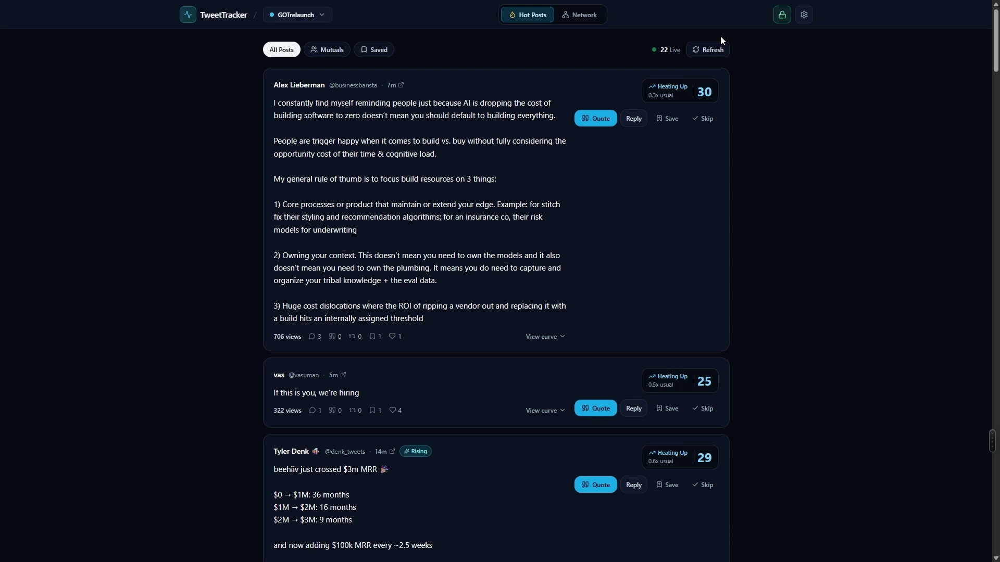
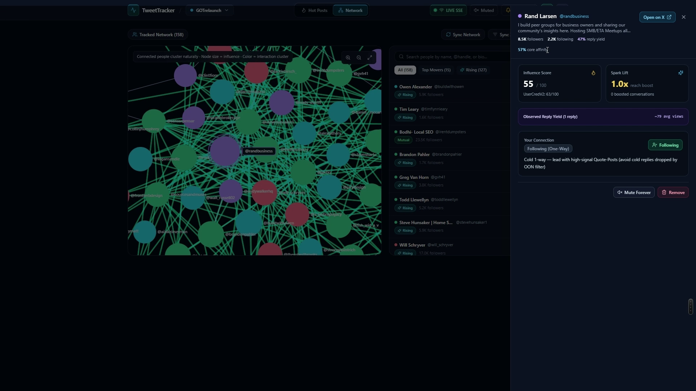

# TweetTracker

[](LICENSE)
[](backend/)
[](web/)
[](https://github.com/xai-org/x-algorithm)

**Stop scrolling timelines all day.** TweetTracker turns X's open-source ranking code ([`xai-org/x-algorithm`](https://github.com/xai-org/x-algorithm)) and social-graph research into a self-hosted **live breakout radar (`Hot Posts`)** and **self-organizing community graph (`Network`)** — so you know which rising posts to reply/quote and which niche accounts actually drive reach.





---

## How It Maps `xai-org/x-algorithm` Into Action

Instead of static "Twitter lists" or vanity engagement dashboards, TweetTracker models how X actually distributes posts across in-network and out-of-network feeds:

- **`Hot Posts` Live Radar (`/radar`):**
  - Polls your tracked graph every 10 minutes and lists posts under `90` minutes old whose **projected 48h views** clear your minimum (`Settings → Alert Rules`), so you reply while a thread is still early.
  - Ranks them by **`expected_reply_reach_score`** — projected reach, your empirical reply yield with that author, how early you are, and X's **`20x` mutual reply boost** (`Mutuals` filter). Each card also shows a momentum score (views vs. the author's usual pace); an optional minimum momentum setting hides slow posts.
  - Recommends **Reply** (for mutuals / warm graph edges) vs. **Quote** (for cold 1-way accounts where `OONRetweetReplyFilter` suppresses cold replies), plus 1-click `Save` (swipe file) and `Skip`.
- **`Network` Auto-Clustering Graph (`/network`):**
  - Force-directed **Sigma.js WebGL** graph colored automatically via Louvain modularity + Seeded-NMF (`SimClusters` tracer) over time-decayed follow, reply, and quote edges — no manual "circle" tagging required.
  - Scores every tracked account on **`UserCredV2`**, **SALSA Influence**, **Spark Lift**, and **Empirical Bayes `Observed Reply Yield`** (`~avg views/reply` + attributed follower lift).
  - **Self-pruning & 2-hop discovery:** Seeds act as a 28-day bootstrap (`SEED_BOOTSTRAP_GRACE_DAYS = 28`). Every 6 hours, the worker promotes 2-hop accounts with high core affinity or reply yield (any follower size; `<50k` accounts get a `Rising` badge) and prunes dead-weight nodes (`< 0.32` hysteresis) automatically. Pruned accounts stay out unless someone in your core starts talking to them.
- **48-Hour Self-Calibrating Tuner & Upstream `Algo Sync Watcher` (`/settings`):**
  - Grades flagged posts at `t = 48h` (`Alert Hit Rate`, `Breakouts Caught`, `Early Head Start`) and tunes alert thresholds once there are at least `10` true breakouts to learn from — thresholds only move when alert quality improves, and are capped below the `0–100` score ceiling (1-click `Undo Last Tune`).
  - Watches `xai-org/x-algorithm` commits daily against `last_synced_sha`, parses `param!(...)` weight diffs deterministically, and summarizes Rust ranking changes via Gemini or Grok.
- **Built-In Spend Guardrails (`~$17–$25/mo`):**
  - Pluggable `XDataProvider` router shipping **`TweetAPI.com`** (per-call batching: `200` post snapshots or `200` follow edges for `1` API unit) + **`FixtureProvider`** (`$0` offline mock mode).
  - Automatic unit-budget pacing (`throttled` at `80%`, `paused` at `95%`) + encrypted-at-rest `/settings` API key vault (Fernet `PBKDF2HMAC-SHA256`).

---

## 5-Minute Quickstart

### Option A — Docker Compose (Recommended)

```bash
git clone https://github.com/gentoftech/tweettracker.git
cd tweettracker
cp .env.example .env
# Optional: set SEED_FIXTURES=true in .env to explore with offline mock data before adding API keys
docker compose up --build
```

Open **`http://localhost:3000`**, create a workspace (enter your `@handle` and 5–20 seed accounts or an X List ID), and paste your `TWEETAPI_API_KEY` (plus optional `GOOGLE_AI_API_KEY` or `XAI_API_KEY` for upstream Rust diff summaries) inside **`Settings → API Keys`**.

### Option B — Local Native Dev (`Python 3.12+` / `uv` + `Node 20+`)

**Windows PowerShell (one-command launcher for API `:8000` + Worker + Web `:3000`):**
```powershell
.\start-local.ps1
```

**macOS / Linux (manual terminals):**
```bash
# 1. Backend API + Worker
cd backend
uv sync
uv run uvicorn tweettracker.api.main:app --reload --port 8000
# (in a second terminal, from backend/: uv run python -m tweettracker.worker.main)

# 2. Next.js 15 Web UI
cd ../web
npm install
npm run dev
```

### 24/7 Cloud Deployment (~$24/mo DigitalOcean Droplet + HTTPS/SSE)

Follow the step-by-step production runbook in **[`docs/DEPLOY_DIGITALOCEAN.md`](docs/DEPLOY_DIGITALOCEAN.md)** (Ubuntu 24.04 + Docker Compose + Caddy automatic TLS + full-screen `TWEETTRACKER_ADMIN_PASSWORD` gate).

---

## Architecture & Research Docs (`docs/`)

- **Deployment Runbook:** [`docs/DEPLOY_DIGITALOCEAN.md`](docs/DEPLOY_DIGITALOCEAN.md)
- **System Overview & State:** [`docs/CONTEXT.md`](docs/CONTEXT.md) · [`docs/PRD.md`](docs/PRD.md) · [`docs/GLOSSARY.md`](docs/GLOSSARY.md)
- **Research Notes:**
  - [`docs/research/how-x-algo-works-today.md`](docs/research/how-x-algo-works-today.md) — Walkthrough of `xai-org/x-algorithm` (`thunder/`, `phoenix/`, `xai-value-model/`, `vm-ranker/`, `simclusters/`, `user-cred-v2/`)
  - [`docs/research/single-and-multi-community-graphs.md`](docs/research/single-and-multi-community-graphs.md) — Time-decayed behavioral graphs, Weighted $s$-Core, SALSA + `UserCredV2`, Seeded-NMF Mini-SimClusters
  - [`docs/research/x-data-provider-pricing.md`](docs/research/x-data-provider-pricing.md) — 2026 X data provider cost benchmark (`TweetAPI.com`, `TwitterAPI.io`, `SocialData.tools`, `TwexAPI`, Official X API v2)
  - [`docs/research/oss-breakdown.md`](docs/research/oss-breakdown.md) — Dependency license audit (`MIT` / `BSD` / `Apache-2.0`)
- **Architecture Decision Records:** [`docs/decisions/`](docs/decisions/)

---

## License

Licensed under the **[Apache License 2.0](LICENSE)** (matching upstream [`xai-org/x-algorithm`](https://github.com/xai-org/x-algorithm)).

---

## Built by 3rd Brain

Built by **Michael Greenberg ([@gentoftech](https://x.com/gentoftech))** at **[3rd Brain](https://3rdbrain.co)**, with **Gemini Argon** in **Google Antigravity**.

Want custom AI workflows, internal tools, and AI-powered operations built inside your company? **[3rd Brain](https://3rdbrain.co)** embeds AI operators and engineers directly into your team to ship systems that actually get used — **[book a call at 3rdbrain.co](https://3rdbrain.co)**.
