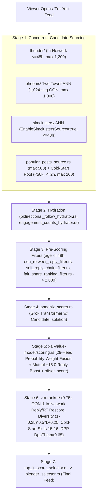

# How the X Algorithm Works Today (Verified Against Live `HEAD = 9106e9f`, Oct 31, 2026)

Related docs: [`../PRD.md`](../PRD.md) | [`oss-breakdown.md`](oss-breakdown.md) | [`single-and-multi-community-graphs.md`](single-and-multi-community-graphs.md)

---

## 1. March 2023 vs. Late 2026 Architecture (`xai-org/x-algorithm`)

xAI replaced Twitter's March 2023 Scala monolith (`twitter/the-algorithm`) with **[`xai-org/x-algorithm`](https://github.com/xai-org/x-algorithm)**—an actively synced monorepo (receiving near-nightly automated sync commits; verified at `9106e9f`, `2026-10-31`, `param.rs` synced `2026-10-30T22:59:56Z`) built around Rust (`home-mixer/`, `thunder/`, `xai-value-model/`, `vm-ranker/`), JAX/Rust (`phoenix/`), and surviving graph jobs (`simclusters/`, `user-cred-v2/`).

| Architectural Layer | Legacy `twitter/the-algorithm` (March 2023) | Live `xai-org/x-algorithm` (`9106e9f` — Oct 31, 2026) |
| :--- | :--- | :--- |
| **Core Runtime** | Scala / JVM microservices (Earlybird, CrMixer) | **Rust** (`home-mixer/`, `thunder/`, `xai-value-model/`, `vm-ranker/`) + **JAX/Rust** (`phoenix/`) |
| **Sequence Context** | Hand-engineered post heuristics & static `RealGraph` tables | **Phoenix sequence modeling** up to `1,024` recent actions (`MaxSeqLengthScoring = 1024`, `MaxSeqLengthRetrieval = 1024`), aggregated with `DENSE_WITH_LONG_DWELL`. |
| **In-Network Store** | Earlybird Lucene index | **`thunder/`**: Sub-millisecond Rust in-memory Kafka store (`<=48h` TTL, `ThunderMaxResults = 1,200`). |
| **Out-of-Network Discovery** | SimClusters v2 + GraphJet only | **`phoenix/` Two-Tower ANN** (`1,000` max) + **Active `SimClusters v2`** (`EnableSimclustersSource = true`, `48h` max age) + **`PopularPosts`** (`500` max) + **`ColdStart`** (`200` max), balanced via `FairShareRankingFilter` (`2,800` budget). |
| **Core Ranker & Reranker** | `HeavyRanker` MaskNet (~10 heads) | **`phoenix/` Candidate-Isolated Transformer** → **`xai-value-model/scoring.rs`** (29 heads + `offset_score`) → **`vm-ranker/`** (`0.75x` OON + reply/retweet rescore, author diversity, and `DppTheta = 0.65` DPP semantic dedup). |
| **Graph Credibility** | Legacy `TweepCred` (0–100) | **`user-cred-v2/`** (launched `2026-04-27`): Daily PageRank-mass job `score = clamp(165.2 + 7.07 * ln(mass), 0, 100)` with VIT snapshot safeguards. |

---

## 2. End-to-End "For You" Request Pipeline (`9106e9f`)

### Critical Filter & Reranker Rules Verified in Source Code
1. **`oon_retweet_reply_filter.rs` (`EnablePhoenixOonReplies = false`):** Drops **all Out-of-Network retweets and plain replies** (plus any reply missing hydration ancestors). Only **Original Posts** and **Quote-Posts** travel Out-of-Network on their own.
2. **`self_reply_chain_filter.rs`:** Keeps pure self-reply threads (`author -> author`) for followers, **drops** self-replies in chains directed at an account the viewer does not follow.
3. **`xai-value-model/inputs.rs` (`bidirectional_boost_eligible`):** Grants the `+15.0` mutual-follow reply boost strictly when `!is_reply && !is_retweet && is_mutual_follow_author`—meaning **both Original Posts and Quote-Posts qualify**, while replies and retweets do not.
4. **`vm-ranker/params.rs` (`EnableOonRescoreForInNetworkRepliesRetweets = true`):** Even **in-network** plain replies and retweets take `OonWeightFactor = 0.75` (`xai-value-model/scoring.rs` lines 206–215; `TopicOonWeightFactor = 0.5`).
5. **`vm-ranker/scoring/dpp_model.rs` (`DppEnabled = true`, `DppTheta = 0.65`, `DppMaxSelectedRank = 150`):** Runs a Determinantal Point Process over candidate post embeddings in the top `150` ranks, dropping semantically redundant posts to `0.0`.

---

## 3. Live Scoring Weights (`home-mixer/params/param.rs` & `vm-ranker/params.rs`)

### 3.1 Probability-Weight Fusion (`xai-value-model/scoring.rs`)
Per xAI's explicit comment in `param.rs` (lines 377–401), weights multiply **predicted viewer-conditioned probabilities** $P(\text{action}_i) \in [0, 1]$ or continuous dwell seconds—**never raw counts**:

| Signal / Parameter Name | `home-mixer` | `vm-ranker` | Operational Meaning |
| :--- | :---: | :---: | :--- |
| **`ShareViaCopyLinkWeight`** | `+20.0` | `+20.0` | Highest single positive head (off-feed link sharing). |
| **`ReplyWeight` (Mutual Original / Quote)** | **`+20.0`** | **`+20.0`** | Base `5.0` + `BidirectionalFollowReplyWeightBoost` (`+15.0`) when `!is_reply && !is_retweet && mutual`. |
| **`ReplyWeight` (Non-Mutual / Reply)** | `+5.0` | `+5.0` | Primary public conversational driver. |
| **`QuoteWeight`** | `+5.0` | `+5.0` | High weight *and* creates a new `!is_reply && !is_retweet` post eligible for OON + Mutual `20x`. |
| **`ShareViaDmWeight` / `ShareWeight`** | `+5.0` / `+2.0` | `+5.0` / `+2.0` | In-app DM and share-sheet distribution. |
| **`FollowAuthorWeight`** | `+4.0` | `+4.0` | Direct profile-to-follow conversion from post. |
| **`RetweetWeight`** | `+1.0` | `+1.0` | Modest boost; penalized `0.75x` in `vm-ranker` and blocked OON. |
| **`FavoriteWeight` (Like)** | `+0.66` | **`+0.50`** | Lowest-friction passive approval (`0.50` in final `vm-ranker`). |
| **`ContClickDwellTimeWeight` / `ClickWeight`** | `+0.40` / `+0.30` | `+0.40` / `+0.30` | Post expansion + continuous post-click reading seconds. |
| **`OpenLinkWeight`** | `+0.20` | `+0.20` | Low credit; leaving X cuts continuous dwell completion. |
| **`DwellWeight` / `ContDwellTimeWeight` / `NotDwelled`** | `+0.05` / `+0.006` / `-0.02` | `+0.05` / `+0.004` / `-0.02` | Inline scroll-stop dwell probability + continuous dwell time vs. fast scroll-past penalty. |
| **`Block` / `NotInterested` / `Mute` / `Report`** | `-31.2` / `-52.272` / `-58.8` / `-234.0` | `-31.2` / **`-47.52`** / `-58.8` / `-234.0` | Heavy negative multipliers (scaled high because baseline negative action probabilities are `<0.1%`). |

### 3.2 Exact Post-Fusion Multipliers (`xai-value-model/scoring.rs`)
1. **`offset_score` (`NEGATIVE_SCORES_OFFSET = 0.001`):** Positive scores become `score + 0.001`; negative scores map linearly into `[0, 0.001)` via `(score + negative_sum) / total_sum * 0.001` so multiplicative discounts behave monotonically.
2. **Author Diversity (`diversity_multiplier`):** `(1.0 - 0.25) * 0.5^k + 0.25` for the $k$-th post by the same author in a batch (`1.00x` → `0.625x` → `0.4375x` → `0.34375x`, floor `0.25x`).
3. **Cold-Start Exploration (`author_cold_start.rs`):** `<50,000` followers (`ColdStartFollowerCap`), age `<= 7,200s` (`2h`), and `<200` impressions qualify via Thompson Sampling (`Beta(0.75, 49.25)`) to lift rank into slots `15–16`.

---

## 4. Designing a True External Tracer (Observability Boundary)

Because public X APIs expose counts (`views`, `likes`, `replies`, `quotes`, `retweets`, `bookmarks`) rather than private client telemetry (`copy_link`, `dm_share`, `dwell_time`, `mute`, `not_interested`, `report`), TweetTracker operates as a **Two-Stage Calibrated Tracer**:
1. **Never multiply raw counts by `param.rs`:** Convert observed counts into **Empirical-Bayes-shrunk per-impression propensities** $\hat{p}_a = \frac{n_a + \alpha_0 \bar{p}_a}{V + \alpha_0}$ so small-view noise doesn't explode scores.
2. **Observable-to-Latent Surrogate Heads:** Map `bookmarks / views`, `quotes / views`, and post length/media dwell structure onto latent `share_via_copy_link` and `dwell_time` propensities, then pass the full head vector through an **exact Python port of `xai-value-model/scoring.rs` + `vm-ranker` multipliers + DPP cosine crowding**.
3. **48-Hour Empirical Calibration (Epic 3):** Fit the latent surrogate mappings against actual 48-hour impression outcomes per community, while **Upstream `Algo Sync Watcher`** tracks nightly `xai-org/x-algorithm` commits so weights and filter gates never go stale.
